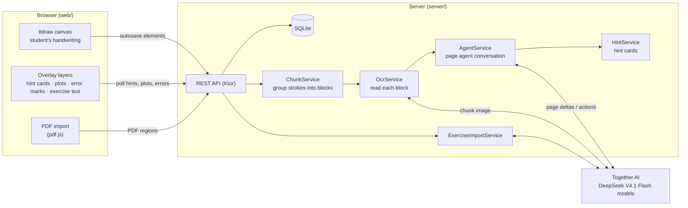
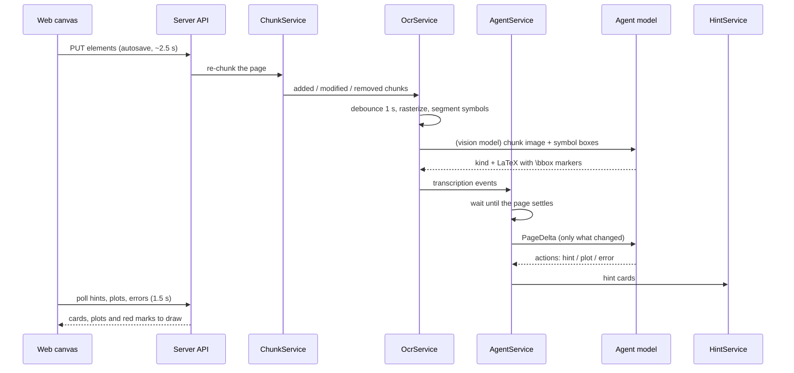
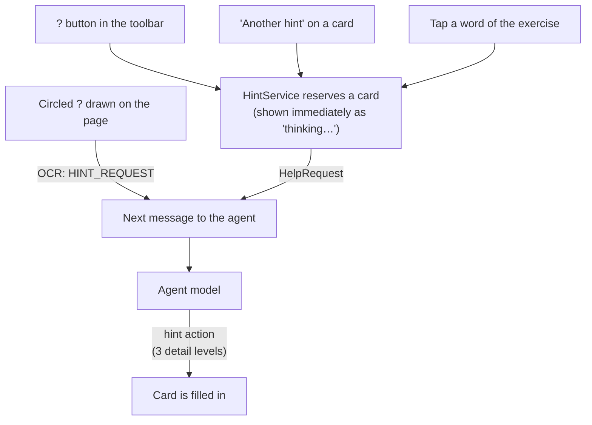

# Hintsight: architecture

This document explains how Hintsight is put together: the three modules, how a
pen stroke becomes a hint card, and the design choices behind it. Commands, the
API and configuration are in [TECHNICAL_DETAILS.md](TECHNICAL_DETAILS.md).

## The big picture

Hintsight is a **Kotlin monorepo** with three modules:

| Module | Runs on | Role |
|---|---|---|
| `shared/` | JVM and JavaScript | The common language: data model, API DTOs, the REST client, stroke chunking, the agent's message and action schema |
| `server/` | JVM | Stores the documents and runs the whole AI pipeline: chunking, OCR, page agent, hints, PDF import |
| `web/` | Browser | The canvas (tldraw) and every overlay the student sees |

Because `shared` is compiled for both sides, the server and the web app use the
**same Kotlin classes** for documents, elements, hints and agent actions. There
is no hand-written JSON contract to keep in sync.

## From a pen stroke to a hint

The heart of Hintsight is a pipeline that turns raw handwriting into something a
language model can reason about. Each stage only processes what changed.

### 1. Capture: the canvas stays a canvas

The student writes on a [tldraw](https://tldraw.dev) canvas. The web app converts
tldraw shapes into generic `Element`s (strokes, shapes, text) and autosaves them.
**Only `web/` knows tldraw.** The server stores tool-agnostic elements, so the
canvas library could be replaced, or a native tablet client added, without
touching the backend.

### 2. Chunking: from strokes to blocks

A page is hundreds of strokes, but a model needs meaningful units. After every
save, `ChunkService` groups strokes that are close to each other into **chunks**:
a formula, a line of text, a sketch, a circled "?". The grouping is purely
geometric and deterministic, with no AI involved. Each chunk gets a stable id
and a content hash, so the rest of the pipeline knows exactly which blocks are
new, changed or gone.

### 3. OCR: from blocks to text

Each new or changed chunk is redrawn as an image on the server and read by a
small vision model. It answers with:

- a **kind**: math, text, a circled "?" (help request), a lone "?", a drawing, or unreadable;
- the **content** as LaTeX.

Before the model call, a classic image-processing step (BoofCV) finds every
symbol's bounding box. The model must tag each transcribed symbol with one of
those boxes. This is what later lets the tutor point at *exactly* the wrong `=`
or `3` on the page.

Results are cached by content: undoing a stroke, or writing the same thing
twice, costs nothing.

### 4. The page agent: one conversation per worksheet

`AgentService` keeps a **running conversation** with the agent model for each document:

- the first message is the whole page: every chunk with position and
  transcription, plus the exercise statement;
- every later message is only the **delta**: chunks added, modified or removed,
  plus any explicit help requests and the chosen hint level;
- the model's previous answers stay in the conversation, so it remembers which
  hints it gave and which plots it drew, and does not repeat itself.

It waits for OCR to finish on the whole page before talking to the model, so it
never reasons about half-transcribed work. The conversation is saved in the
database and survives restarts.

The model answers with a list of **actions**, never free text:

| Action | What the student sees |
|---|---|
| `hint` | A yellow card, written at three detail levels |
| `plot` | A plot button next to the function, opening a graph |
| `error` | A red box around the wrong symbol, with an explanation |

### 5. Rendering: the model decides, the code draws

The web app draws everything itself from the structured actions:

- **Hint cards** float on the page in page coordinates, can be dragged, and show
  the level chosen with the slider.
- **Plots** are computed in the browser: the model only supplies the expression
  and the points the *student* computed, and the client samples the function and
  draws it (SVG for one variable, three.js for two).
- **Error marks** use the symbol box from the OCR, mapped back to page coordinates.

This split ("the model decides, deterministic code draws") keeps the visuals
exact. A plot is a real graph of the function, not a model's guess at one.

## Asking for help

All the ways to ask for help go through the **same agent conversation**, so the
tutor always has the full context of the page:

The student chooses the **hint level** (minimal, medium, guided) with a slider.
The agent always writes all three levels, so moving the slider is instant and
needs no new AI call.

## Importing exercises

The PDF never leaves the browser: pdf.js renders it, and the student selects
regions on the page. Only the selected regions are sent to the server, as
images, together with the text pdf.js found in them. The vision model turns each
region into Markdown with LaTeX formulas, and figures are cropped and stored as
images. The browser checks every formula with KaTeX and, if one does not render,
asks the model once more with the error. The result becomes the worksheet's
exercise statement, shown at the top of the page, where every word can be
tapped for a definition.

## Design choices

**Kotlin end to end.** One language and one set of data classes for server,
shared logic and web client. Native tablet apps could reuse `shared/` as they are.

**Deterministic where possible, AI where needed.** Chunking, symbol
segmentation, coordinate mapping and plotting are plain code. The models only
read handwriting and decide what to say.

**Incremental everything.** Content hashes, debouncing, caching and delta
messages mean that writing one more symbol costs one small OCR call and a short
agent turn, not a re-read of the whole page.

**Structured output only.** Every model answer is JSON validated against Kotlin
classes. A malformed answer is rejected instead of being shown to the student.

**The tutor never solves.** This is enforced in the agent prompt (no final
results, Socratic hints, escalation one step at a time) and in the product:
plots show only the student's own points.

**Degrades gracefully.** Without an API key Hintsight is a working drawing app.
A failed AI call marks a card as failed and is retried with the next change; it
never blocks the canvas.

## Where state lives

| Kind of state | Where | Persistent |
|---|---|---|
| Documents, exercise, hint level | SQLite | yes |
| Canvas elements | SQLite | yes |
| Agent conversation (plots and errors are rebuilt from it) | SQLite | yes |
| Imported figures | SQLite (assets) | yes |
| Chunks, OCR cache, hint cards | Server memory | no |
| Card positions while dragging, open panels | Browser | no |

## Code map

| Concern | Where |
|---|---|
| Data model and API client | `shared/.../domain`, `shared/.../dto`, `shared/.../api` |
| Stroke clustering and stable ids | `shared/.../chunking` |
| Agent schema (messages and actions) | `shared/.../agent/Agent.kt` |
| Chunk events | `server/.../chunking/ChunkService.kt` |
| Rasterization, segmentation, OCR | `server/.../ocr` |
| Agent prompt and model call | `server/.../agent/PageAgent.kt` |
| Conversation loop and action handling | `server/.../agent/AgentService.kt` |
| Hint card lifecycle | `server/.../hint/HintService.kt` |
| PDF region conversion | `server/.../exercise` |
| Canvas and tldraw mapping | `web/.../ui/Canvas.kt`, `web/.../tldraw` |
| Overlays | `web/.../ui/HintLayer.kt`, `PlotLayer.kt`, `Plot3D.kt`, `ErrorLayer.kt`, `PageLayers.kt` |
| Toolbar and hint slider | `web/.../ui/Toolbar.kt` |
| PDF import screen | `web/.../ui/PdfImport.kt` |
| Debug inspector (`?debug`) | `web/.../ui/DebugDrawer.kt`, `DebugLayer.kt` |
