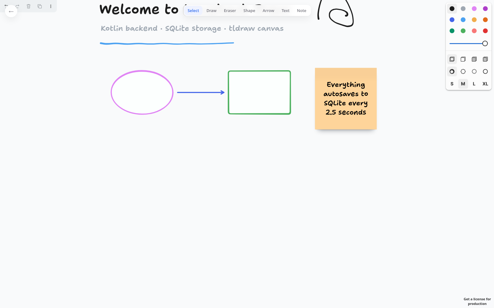

# Lauzhack Draw



A cross-platform drawing app backend + web frontend, built with Kotlin.

- **`server/`** — Ktor 3 + Exposed + SQLite REST backend (Kotlin/JVM)
- **`shared/`** — Kotlin Multiplatform module: tool-agnostic drawing domain model,
  DTOs and a Ktor REST client, reused by every current and future client
- **`web/`** — Kotlin/JS + React (kotlin-wrappers) frontend with a
  [tldraw](https://tldraw.dev) infinite canvas, wired to the backend through a
  thin adapter layer

The UI is chrome-free: the canvas fills the whole page, with only a floating
back button and a minimal floating tool pill on top. tldraw's own UI
(minimap, zoom controls, menus, default toolbar, pages) is hidden; colors
and fills come from the contextual style panel, and keyboard shortcuts (V,
D, E, R, A, T) mirror the pill. Autosave runs silently in the background.

The canvas behaves like a **vertical scrolling document**: the camera is
constrained to a tall page (960×4800) with `contain` behavior — the mouse
wheel pans vertically instead of zooming, zooming out past the fit zoom pins
the page, and zooming in keeps the camera inside the document bounds
(`wheelBehavior: pan`, `initialZoom: fit-x-100`).

The database stores **generic drawing data** (strokes, geometry, text, arrows
with style/color info) — tldraw is just the web-facing editor. Android and iOS
apps planned later will consume the same API and the same `shared` module.

## Running in development

```sh
# terminal 1 — backend on :8080
./gradlew :server:run

# terminal 2 — web dev server on :8081 (proxies /api to :8080)
./gradlew :web:jsBrowserDevelopmentRun --continuous
```

Open http://localhost:8081.

## Production build

```sh
./gradlew :web:jsBrowserDistribution   # bundle → web/build/dist/js/productionExecutable
./gradlew :server:run                   # serves the bundle + API on :8080
```

## API

```
GET    /api/documents                       list documents
POST   /api/documents                       { "name": "..." } → create
GET    /api/documents/{id}                  document metadata
DELETE /api/documents/{id}

GET    /api/documents/{id}/elements         all elements (z-ordered)
PUT    /api/documents/{id}/elements          batch replace (web autosave)
POST   /api/documents/{id}/elements         create one
PATCH  /api/documents/{id}/elements/{eid}   replace one
DELETE /api/documents/{id}/elements/{eid}   delete one
```

Elements are polymorphic via the `kind` discriminator:

```json
{
  "id": "shape:8f9c...",
  "type": "stroke",
  "x": 120, "y": 40, "rotation": 0,
  "zIndex": "a1",
  "style": { "color": "red", "size": "m" },
  "data": { "kind": "stroke", "segments": [ { "points": [0, 0, 12, 30], "type": "free" } ], "complete": true }
}
```

## Architecture notes

- **Only `web/` knows tldraw exists.** `tldraw/Mapper.kt` converts tldraw store
  records to the shared `Element` model and back; everything behind the REST
  boundary is tool-agnostic.
- **New widget types need no DB migration**: `data`/`style` are JSON, and new
  `ElementData` subclasses can be added in `shared` only.
- MVP limitations (documented on purpose): bound arrows are saved as free
  arrows, image/asset shapes and groups are not persisted yet, single page.
- Node packages for the web app are installed by the Kotlin Gradle plugin's
  bundled Yarn inside the build (KGP does not support pnpm for this — it's an
  implementation detail of the build, not a project-level choice). Use pnpm for
  any direct JS tooling you add yourself. `tldraw` is pinned to an exact version
  on purpose — tldraw does not follow semver.

## Tooling

- Kotlin 2.4.21, Ktor 3.6.1, Exposed 1.6.1, SQLite via `sqlite-jdbc`
- kotlin-wrappers (React 19), tldraw 5.6.2
- Server scaffolded with the official `ktor` CLI, adapted to a multi-module build
